<div align="center">

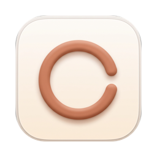

# Respiro

Seu Mac diz que o disco tá cheio e joga a culpa em "Dados do Sistema"?<br>
O Respiro abre essa caixa-preta e devolve o espaço que seus projetos esqueceram para trás.

[](#instalando)
[](https://github.com/dzn7/respiro-app/releases/latest)
[](https://www.electronjs.org/)
[](#privacidade)
[](LICENSE)

### [Baixar para Mac](https://github.com/dzn7/respiro-app/releases/latest)

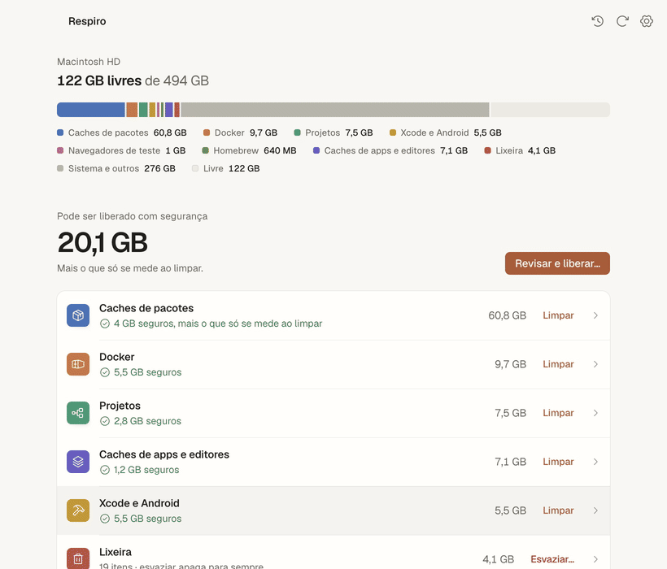

<sub>Gravado com dados de exemplo e uma limpeza encenada. Nada foi apagado nessa brincadeira.</sub>

</div>

<br>

## Onde foi parar meu disco?

Se você programa no Mac, conhece a cena. Um dia aparece o aviso de disco cheio, você abre o Armazenamento do macOS e a maior fatia se chama "Dados do Sistema". Sem lista, sem explicação, sem botão.

Fui procurar no Terminal. No meu Mac, só o store do pnpm tinha 11 GB e o Docker passava de 60 GB entre imagens, containers parados e cache de build. Somando `node_modules` de projeto antigo, DerivedData e os navegadores que o Playwright baixa, era espaço de sobra para um sistema inteiro.

Dava para sair apagando com `rm -rf`. Também dava para apagar o volume do Postgres errado numa sexta à noite. Fiz o Respiro para não precisar escolher entre disco cheio e susto.

## Como é usar

1. **Abre o app.** Em menos de um segundo aparece o disco, uma barra colorida mostrando quem ocupa o quê e, em letra grande, quanto dá para liberar sem risco.
2. **Clica numa categoria.** Cada item vem separado em seguro, pede atenção ou em uso, com o motivo escrito em português. Listas grandes ganham filtro e busca.
3. **Aperta "Revisar e liberar…".** Ele mostra a lista exata do que vai sair e como. Pasta vai para a Lixeira. Cache de ferramenta é limpo pelo comando da própria ferramenta.
4. **Confere o resultado.** O app compara o espaço livre antes e depois. Quando o disco ganha menos do que foi removido, ele conta o motivo em vez de fingir que deu tudo certo.

Na primeira vez, uma apresentação curta de cinco passos mostra o que ele faz enquanto a análise já roda por trás. Depois, fechar a janela deixa o Respiro na barra de menus com o espaço livre à vista; se o disco apertar, o anel fica vermelho. No Histórico tem um gráfico do espaço livre ao longo dos meses. E o app fala português, inglês e espanhol, seguindo o idioma do seu Mac.

<details>
<summary><b>Quero ver mais telas</b></summary>
<br>

<table>
<tr>
<td width="50%">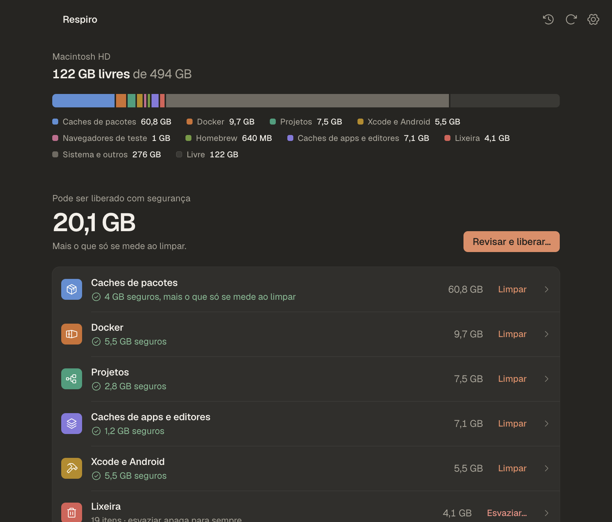<p align="center"><sub>Tela principal, modo escuro</sub></p></td>
<td width="50%">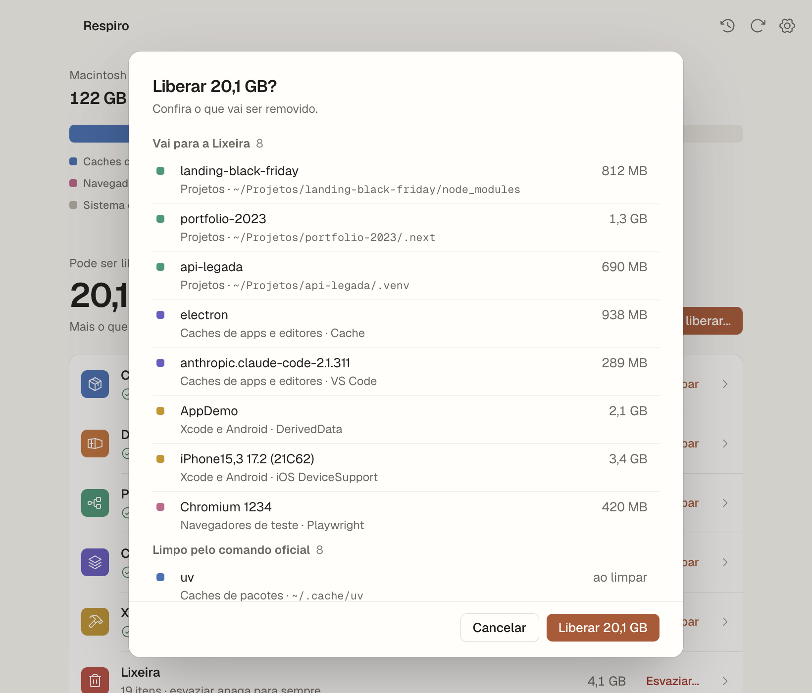<p align="center"><sub>Antes de apagar, a lista inteira</sub></p></td>
</tr>
<tr>
<td>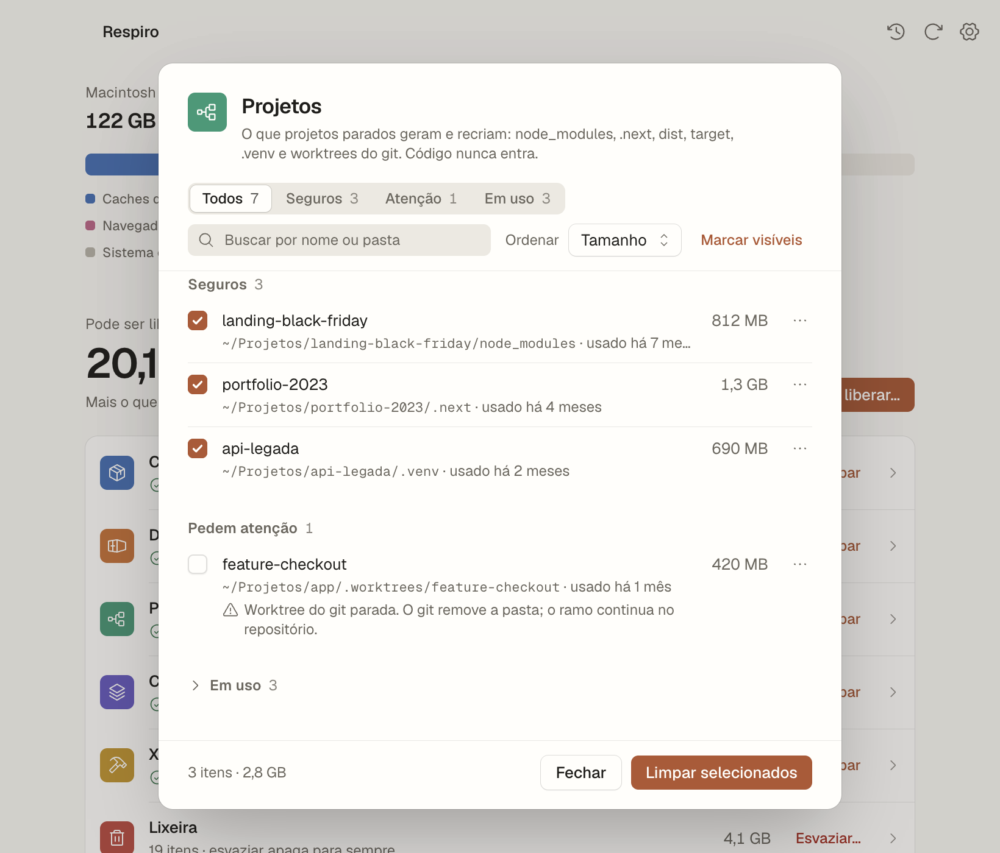<p align="center"><sub>Seguros em cima, em uso recolhidos</sub></p></td>
<td>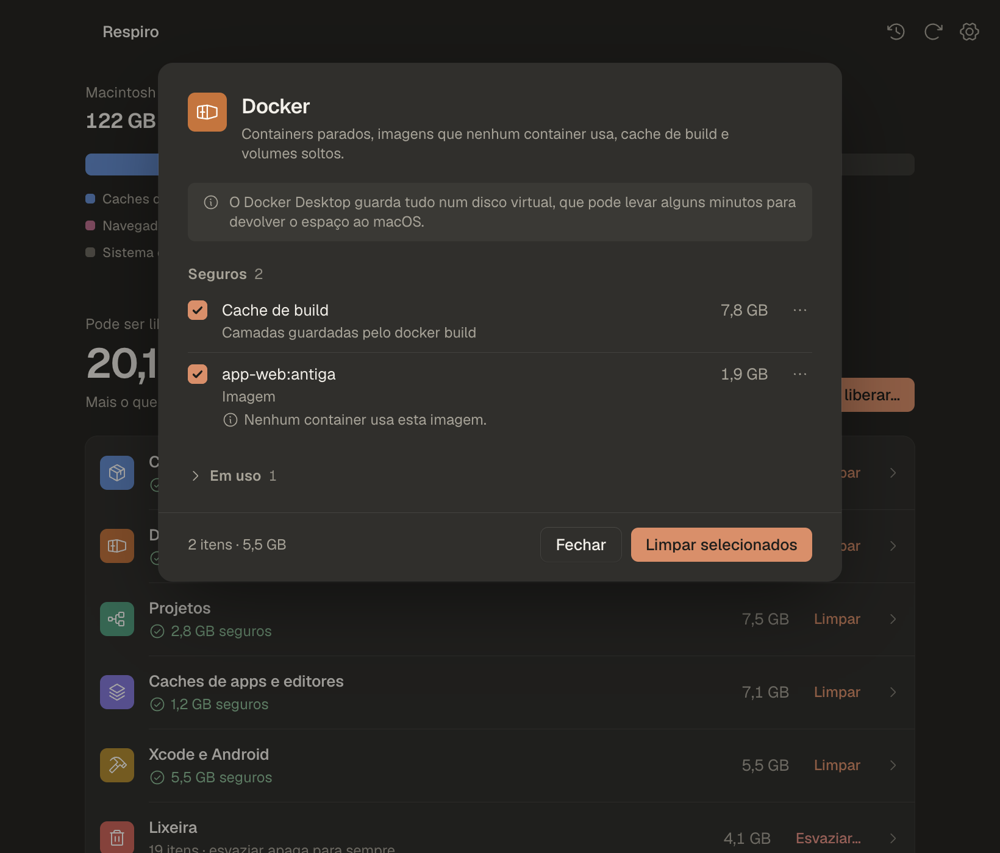<p align="center"><sub>Docker, com volume um por vez</sub></p></td>
</tr>
<tr>
<td>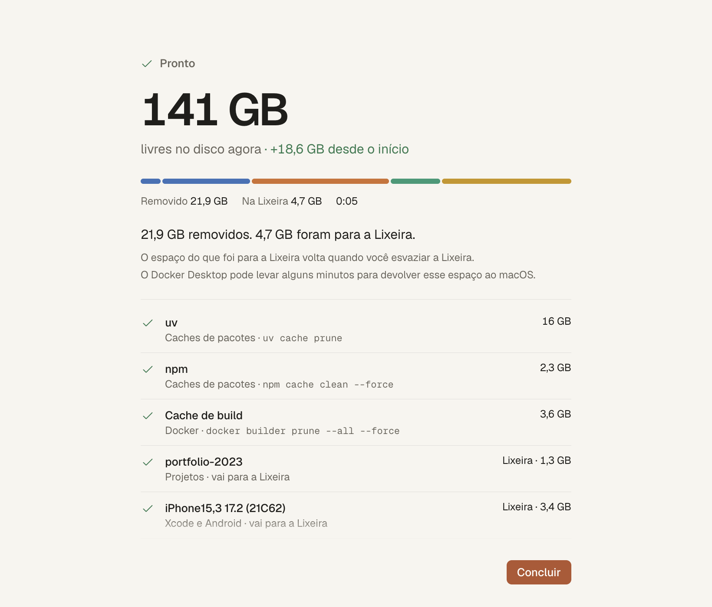<p align="center"><sub>A limpeza acontecendo, item por item</sub></p></td>
<td>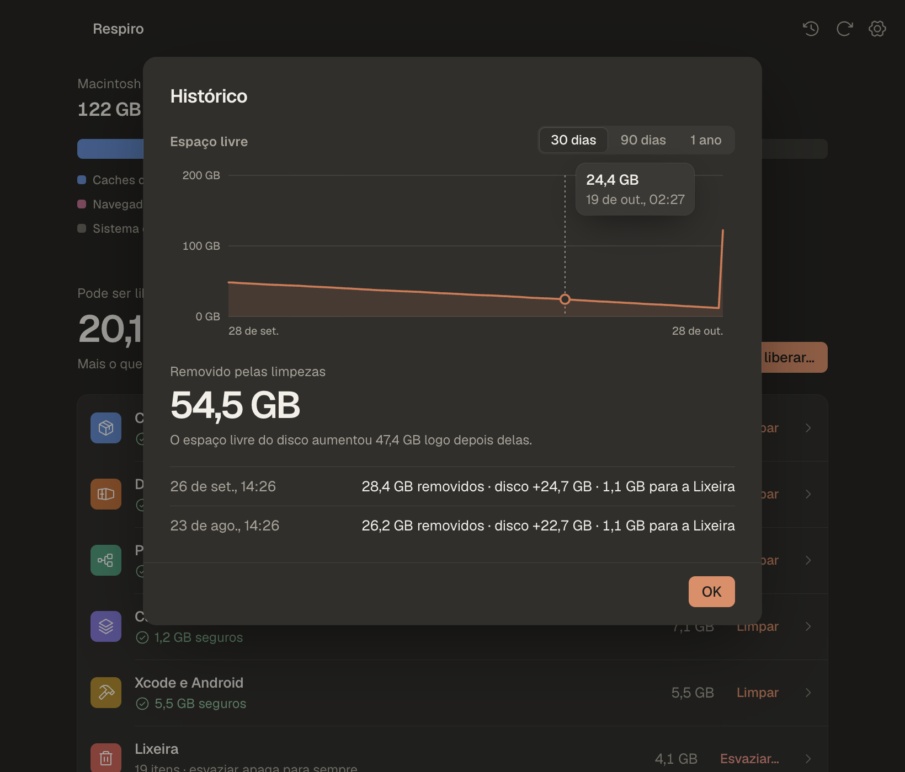<p align="center"><sub>Histórico com o gráfico do espaço livre</sub></p></td>
</tr>
<tr>
<td>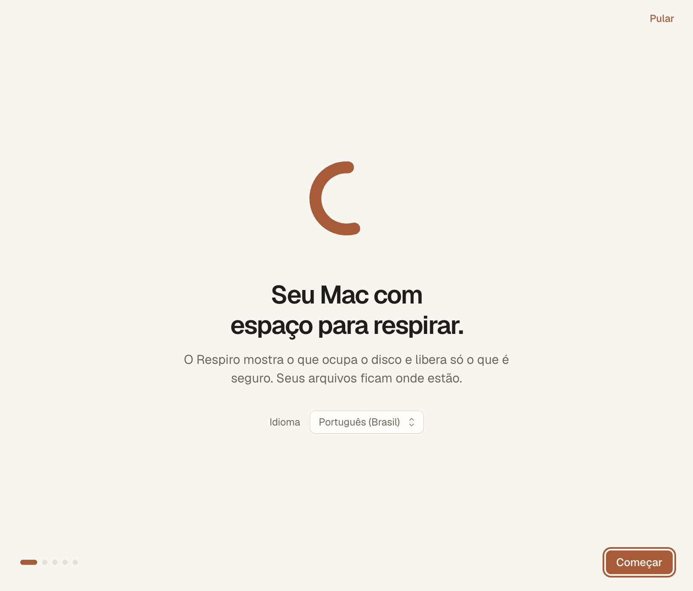<p align="center"><sub>Primeira abertura</sub></p></td>
<td>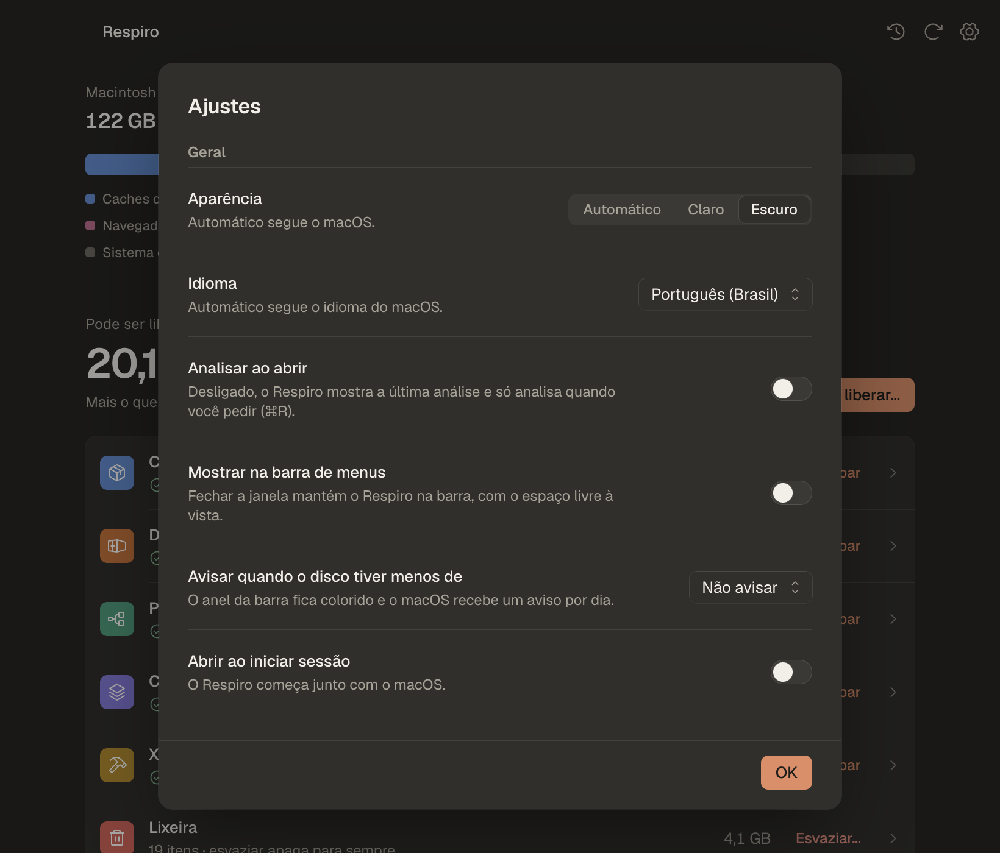<p align="center"><sub>Ajustes</sub></p></td>
</tr>
</table>

</details>

## O que ele encontra

Só aparece o que existe na sua máquina. Não usa Docker? A categoria nem mostra a cara.

| | Onde mora | Como ele limpa |
|---|---|---|
| **Caches de pacotes** | pnpm, npm, Yarn, Bun, pip, uv, Go, Cargo, Gradle, Maven, CocoaPods, pub | o comando de cada um (`pnpm store prune`, `uv cache prune`, `go clean -modcache`, `pod cache clean --all`…); quem não tem comando vai para a Lixeira |
| **Docker** | containers parados, imagens sem uso, cache de build, volumes soltos | `docker container rm`, `docker image rm`, `docker builder prune`, volume só um de cada vez, e um botão para o Docker Desktop devolver o espaço ao macOS |
| **Projetos** | `node_modules`, `.next`, `dist`, `target`, `.venv` e worktrees do git de projetos parados há mais de 30 dias (você ajusta) | Lixeira, `cargo clean` ou `git worktree remove` (sem `--force`: com mudança, o git recusa) |
| **Xcode e Android** | DerivedData, simulador que não abre mais, cache, DeviceSupport antigo, emuladores e imagens do Android | Lixeira, `xcrun simctl delete unavailable`, `avdmanager`, `sdkmanager` |
| **Navegadores de teste** | versões do Playwright, Cypress e Puppeteer que nenhum projeto usa | Lixeira, com a mesma regra que o Playwright usa |
| **Homebrew** | instaladores baixados e versões antigas | `brew cleanup --prune=all` |
| **Caches de apps e editores** | `~/Library/Caches`, `~/Library/Logs`, extensão velha do VS Code/Cursor/Windsurf, cache de IDE JetBrains antiga | Lixeira, e o que é da Apple ele nem toca |
| **Lixeira** | `~/.Trash` | esvazia, mas só depois de você marcar "entendi" |

## "Tá, mas é seguro?"

Pergunta justa. A resposta curta: ele não mexe em documento, foto, código, configuração nem nada que você criou. E não existe `rm` em lugar nenhum do código.

A resposta longa é o jeito como ele separa as coisas:

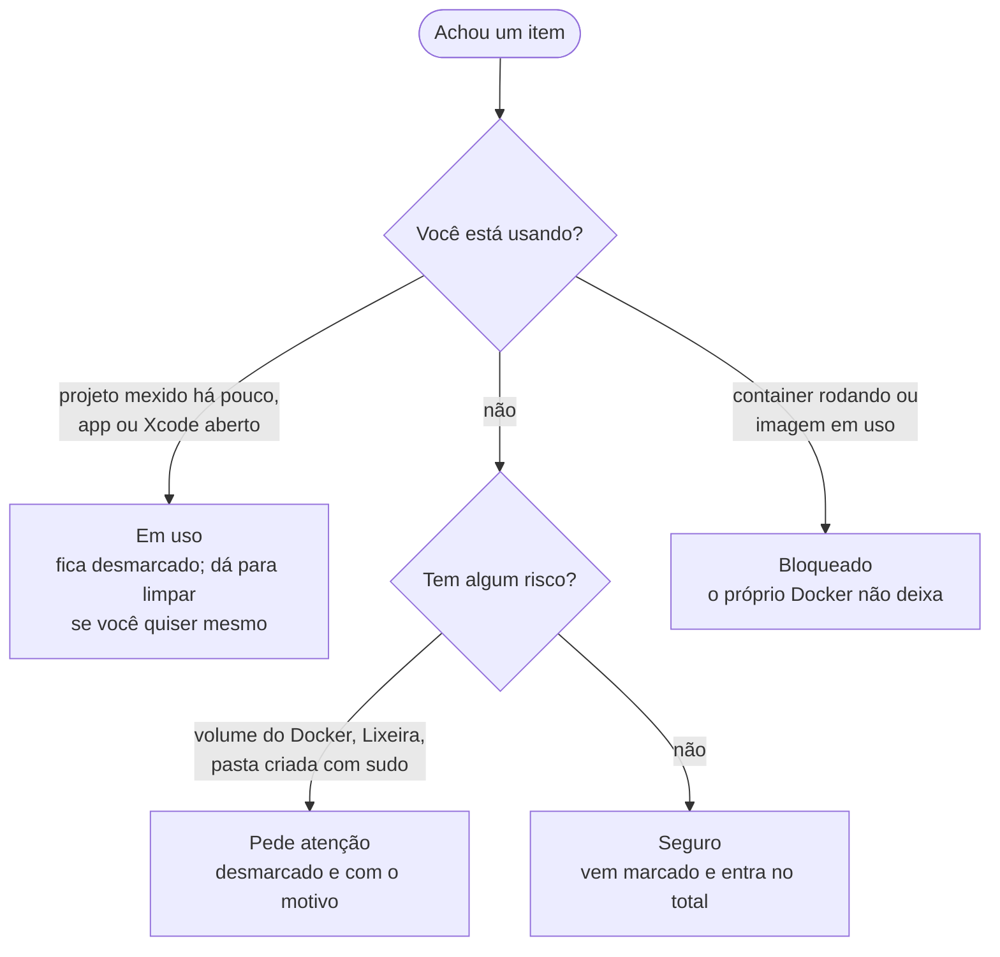

<details>
<summary><b>Me mostra as regras de verdade</b></summary>
<br>

- Todo código que apaga alguma coisa mora num arquivo só, [`src/main/cleaner.js`](src/main/cleaner.js). Se alguém tentar apagar fora dele, o `npm run check` reprova antes de chegar no app.
- A tela nunca manda caminho de pasta para o processo que apaga. Ela manda um id, e o processo principal procura o item na última análise.
- Na hora de limpar, tudo é conferido de novo: se a pasta mudou, virou atalho ou o projeto voltou a ser usado, ele recusa e explica.
- Os comandos vêm de uma lista fechada e rodam sem shell. Nada de concatenar texto em comando.
- Pasta vai para a Lixeira. Apagar para sempre só acontece por comando oficial da ferramenta ou quando você esvazia a Lixeira.
- Pasta criada com `sudo`: o macOS pede sua senha, o Respiro devolve a pasta para o seu usuário e só então manda para a Lixeira. Ele nunca apaga nada como administrador.

</details>

> [!TIP]
> Quer só olhar sem medo? Ligue o **modo simular** em Ajustes (<kbd>⌘</kbd> <kbd>,</kbd>). O fluxo inteiro roda e no final ele diz quanto liberaria, sem apagar um byte.

## Instalando

1. Baixe o `.dmg` na [página de releases](https://github.com/dzn7/respiro-app/releases/latest).
2. Abra e arraste o Respiro para Aplicativos.
3. Abra o app.

> [!WARNING]
> Ainda não paguei a Apple para assinar o app, então na primeira vez o macOS vai bloquear. É só ir em **Ajustes do Sistema › Privacidade e Segurança** e clicar em **Abrir Mesmo Assim**.

<details>
<summary>Prefere resolver pelo Terminal?</summary>

```sh
xattr -dr com.apple.quarantine /Applications/Respiro.app
```

</details>

Por enquanto o build é para Apple Silicon. Tem Mac Intel? Clone o projeto e rode `npm run release` nele.

### Permissões, sem susto

| O macOS pode pedir | Para quê | Se você negar |
|---|---|---|
| Acesso Total ao Disco | medir a Lixeira | tudo funciona, só a Lixeira fica sem tamanho |
| Acesso a Documentos, Mesa e Downloads | achar pastas geradas de projetos guardados ali | ele pula essas pastas |
| Senha de administrador | devolver para você uma pasta criada com `sudo` | aquele item não é limpo e nada muda |

## Atalhos

| Para | Aperte |
|---|---|
| Analisar de novo | <kbd>⌘</kbd> <kbd>R</kbd> |
| Abrir os Ajustes | <kbd>⌘</kbd> <kbd>,</kbd> |
| Ver o histórico | <kbd>⌘</kbd> <kbd>Y</kbd> |
| Voltar um passo ou fechar | <kbd>Esc</kbd> |
| Marcar um item | <kbd>Espaço</kbd> |
| Andar por listas, menus e filtros | <kbd>↑</kbd> <kbd>↓</kbd> <kbd>←</kbd> <kbd>→</kbd> |

Dá para usar tudo só com teclado, o VoiceOver lê cada tela, e se o seu Mac está com "Reduzir movimento" ligado, o app para de animar.

## Privacidade

Nada sai do seu Mac. Sem conta, sem rede, sem telemetria. O que ele guarda (última análise, histórico e preferências) fica em `~/Library/Application Support/Respiro/respiro.json`.

## Perguntas que você talvez tenha

<details>
<summary><b>Limpei o pnpm e o disco ganhou bem menos do que o app mostrou. Bug?</b></summary>
<br>

Não. No Mac, o pnpm (e o Bun) **clonam** arquivos do store para dentro dos `node_modules` usando um truque do APFS: as duas cópias dividem o mesmo espaço físico. Apagar uma delas não libera nada enquanto a outra existir. Por isso o Respiro mostra dois números no fim: quanto a ferramenta removeu e quanto o disco ganhou de verdade. No meu teste, o `pnpm store prune` tirou 3,7 GB do store e o disco ganhou 0,16 GB.

</details>

<details>
<summary><b>Limpei o Docker e o espaço não voltou.</b></summary>
<br>

O Docker Desktop guarda tudo num disco virtual. O espaço é liberado lá dentro na hora e volta para o macOS alguns minutos depois. Paciência de um café.

</details>

<details>
<summary><b>Mandei coisa para a Lixeira e o espaço livre continuou igual.</b></summary>
<br>

A Lixeira ainda ocupa espaço. Quando você tiver certeza, esvazie pela própria linha "Lixeira" no app.

</details>

<details>
<summary><b>Posso apagar o node_modules de um projeto que estou usando?</b></summary>
<br>

Pode. Ele aparece em "Em uso", desmarcado. Marque, leia o aviso e confirme. Quando voltar ao projeto, é rodar `pnpm install` (ou `npm install`). Se mudar de ideia antes, a pasta está na Lixeira.

</details>

<details>
<summary><b>Apareceu "Criado pelo administrador (sudo)". Que isso?</b></summary>
<br>

Algum dia alguma ferramenta rodou com `sudo` e deixou a pasta com dono `root` (o `node-gyp` adora fazer isso). Sem senha ninguém mexe nela. Na hora de limpar, o macOS pede sua senha uma vez, o Respiro devolve a pasta para você e aí manda para a Lixeira.

</details>

<details>
<summary><b>Por que o espaço livre é diferente do que o Finder mostra?</b></summary>
<br>

O Finder soma o espaço "purgável", que o macOS ainda pode liberar sozinho. O Respiro mostra só o que está livre agora, então o número dele pode ser um pouco menor.

</details>

## Para quem quer mexer no código

É Electron com JavaScript puro, checado pelo TypeScript via JSDoc. Não tem framework de interface, não tem bundler e o app não carrega nenhuma dependência em produção.

```sh
git clone https://github.com/dzn7/respiro-app.git
cd respiro-app
npm install
npm start
```

| Comando | Faz o quê |
|---|---|
| `npm start` | abre o app |
| `npm run verify` | roda as regras do projeto, o typecheck e os testes |
| `npm run check` | reprova Lucide, cor fora dos tokens, exclusão fora do `cleaner.js`, controle nativo e contraste baixo |
| `npm test` | testes com `node --test` |
| `npm run shot -- --theme=dark --out=/tmp/tela.png` | tira um print da janela |
| `npm run release` | gera o `.app` e o `.dmg` com a janela de instalação |

<details>
<summary><b>Como as pastas estão organizadas</b></summary>

```
src/
  main/
    main.js            janela, menu e IPC
    preload.cjs        a ponte entre a tela e o resto
    scan.js            roda as categorias em paralelo
    categories/*.js    uma categoria por arquivo, só leitura
    cleaner.js         o único lugar que apaga
    sys.js             du, statfs, processos
    store.js           última análise, histórico e preferências
  renderer/
    index.html, app.js, app.css
    tokens.css         cores, tipografia e tempos de animação
    controls.js        checkbox, switch, select, menu e companhia
    motion.js          número contando, troca de tela, item saindo
    fonts/             Geist e Geist Mono
test/                  node --test
scripts/               checagens, ícone, fundo do instalador e release
```

</details>

<details>
<summary><b>Quero adicionar um cache novo (uv, Gradle, Cypress…)</b></summary>
<br>

O passo a passo está na skill [`respiro-categoria`](.agents/skills/respiro-categoria/SKILL.md). Em resumo: descubra o comando oficial de limpeza da ferramenta, crie a categoria em `src/main/categories/` só lendo o disco, registre o comando em `cleaner.js` e escreva um teste para a parte de proteção. Tem um checklist de segurança no fim que precisa fechar inteiro.

</details>

Para entender as decisões: [`PRD.md`](PRD.md) explica o produto e as regras de segurança, [`UI.md`](UI.md) é o sistema de design inteiro e [`AGENTS.md`](AGENTS.md) é o resumo para quem programa com agentes.

## O que vem por aí

- [x] Pacotes, Docker, `node_modules`, Xcode, Playwright, Homebrew, caches e Lixeira
- [x] Modo simular, histórico e ganho real medido
- [x] Filtros, itens ignorados, tema claro e escuro
- [x] Pastas do `root` com a senha do macOS
- [x] uv, Go, Cargo, Gradle, Maven, CocoaPods, pub, `.next`, `target`, `.venv`, worktrees
- [x] Puppeteer, Cypress, `iOS DeviceSupport`, Android, extensões de editor, JetBrains
- [x] Português, inglês e espanhol
- [x] Barra de menus com aviso de disco cheio, gráfico do espaço livre, boas-vindas
- [ ] Escolher em quais pastas procurar projetos
- [ ] Build para Intel, assinatura e notarização

Sentiu falta de alguma ferramenta? [Abre uma issue](https://github.com/dzn7/respiro-app/issues) e me conta onde ela guarda o cache.

## Licença

© 2026 Derick Mackenzie. Todos os direitos reservados.

O código está aberto para leitura e o app é de graça para uso pessoal. Copiar, modificar, redistribuir ou usar o nome e o ícone em outro projeto precisa de autorização. Os detalhes estão em [`LICENSE`](LICENSE).

## Créditos

- Fontes [Geist e Geist Mono](https://vercel.com/font), da Vercel ([SIL OFL 1.1](src/renderer/fonts/LICENSE-Geist.txt)).
- Ícones [Phosphor](https://phosphoricons.com) ([MIT](src/renderer/LICENSE-Phosphor.txt)).
- [Electron](https://www.electronjs.org/).

<div align="center">
<br>
<sub>Se o Respiro te devolveu uns gigas, conta lá nas issues. Eu vou gostar de saber.</sub>
</div>
