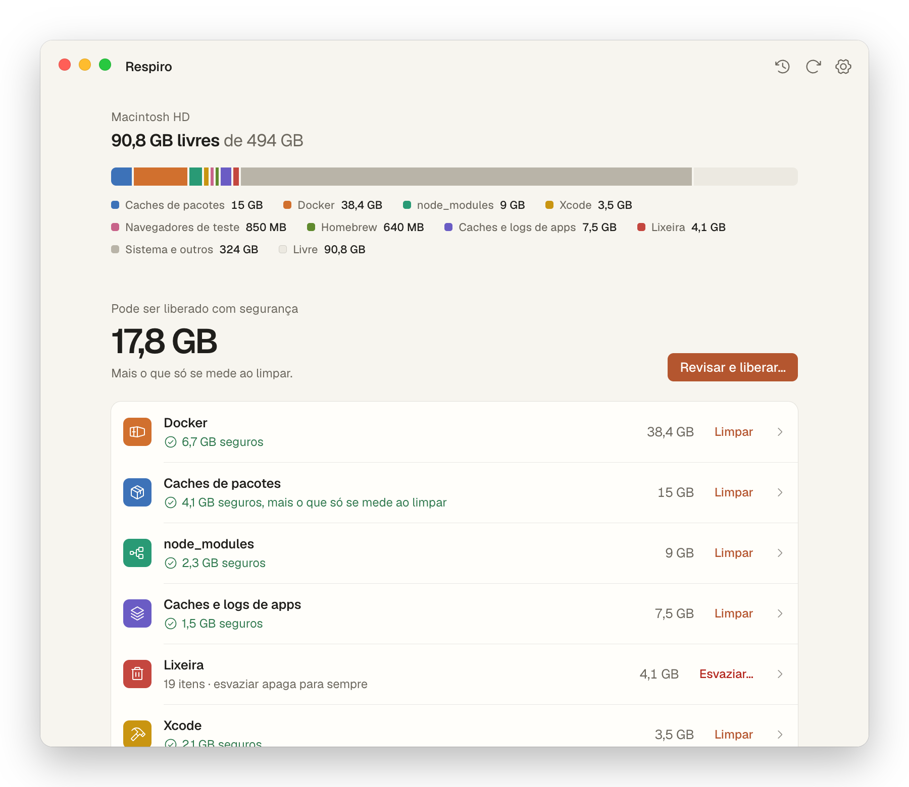
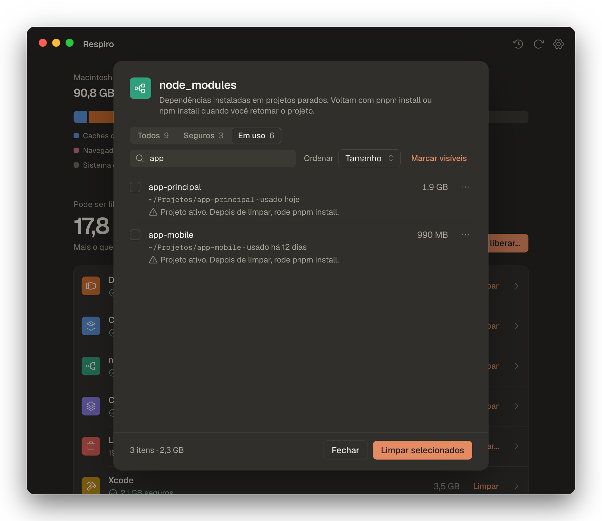
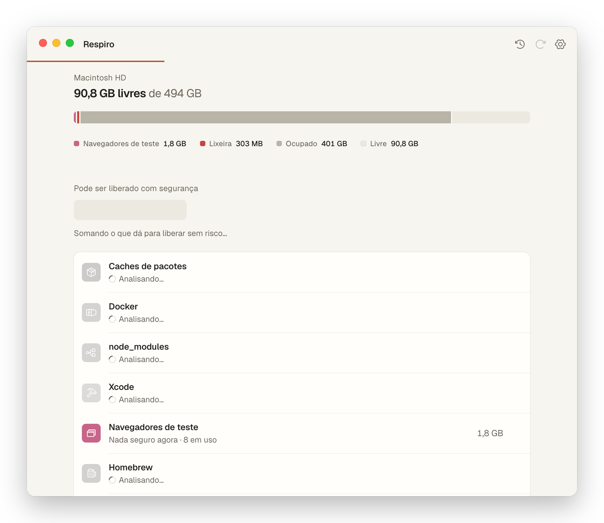
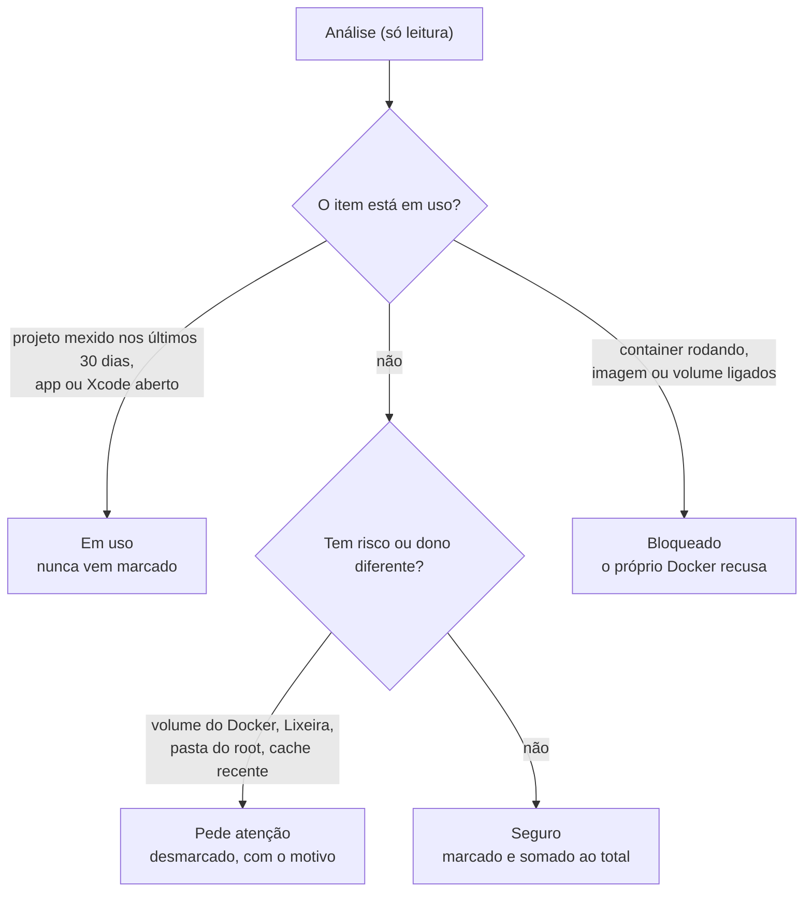
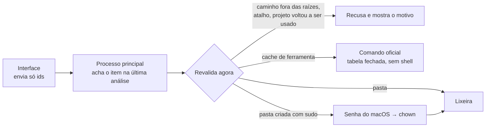

<div align="center">


# Respiro

**Seu Mac de dev, com espaço para respirar.**

Mostra o que ocupa o disco de quem programa e libera o que dá para apagar sem medo:
caches de pacotes, Docker, `node_modules` esquecidos, Xcode, navegadores de teste e Homebrew.

[](#instalação)
[](https://github.com/dzn7/respiro-app/releases/latest)
[](https://www.electronjs.org/)
[](#privacidade)
[](#)
[](LICENSE)

[**Baixar o .dmg**](https://github.com/dzn7/respiro-app/releases/latest) ·
[Como funciona](#como-o-respiro-decide-o-que-é-seguro) ·
[Desenvolvimento](#desenvolvimento) ·
[Perguntas](#perguntas-frequentes)

<br>

<picture>
  <source media="(prefers-color-scheme: dark)" srcset="docs/assets/screenshots/main-dark.png">
  
</picture>

<sub>A imagem acompanha o tema do seu GitHub. Dados de demonstração.</sub>

</div>

---

## Por que existe

Em um Mac de desenvolvimento, dezenas de gigabytes somem em pastas que ninguém olha: o store do pnpm, imagens e volumes do Docker, `node_modules` de projetos de meses atrás, DerivedData, navegadores baixados pelo Playwright. O Armazenamento do macOS chama tudo isso de "Dados do Sistema" e não diz o que é seguro apagar.

O Respiro abre em menos de um segundo, mostra o estado do disco e separa o que **pode sair sem risco** do que **pede atenção**. Para limpar, usa o comando oficial de cada ferramenta e manda pastas para a Lixeira. Arquivos pessoais e código-fonte ficam fora do alcance dele.

> [!IMPORTANT]
> O Respiro nunca roda `rm`. Cada exclusão passa por um único módulo, com tabela fechada de comandos e regras de caminho testadas. Veja [Segurança](#segurança).

## O que ele faz

| | |
|---|---|
| **Vê o disco em um segundo** | Espaço livre e ocupado numa barra segmentada por categoria. A última análise abre na hora; a nova roda em segundo plano. |
| **Separa o seguro do resto** | Cada item cai em *Seguro* (vem marcado), *Pede atenção* (desmarcado, com o motivo) ou *Em uso* (projeto ativo, app aberto). |
| **Limpa do jeito certo** | `pnpm store prune`, `npm cache clean`, `docker image rm`, `brew cleanup`… Pastas sem comando oficial vão para a Lixeira. |
| **Mostra antes de apagar** | A confirmação lista cada item, o método e o total. O modo **simular** percorre tudo sem apagar nada. |
| **Mede o ganho real** | Compara o espaço livre antes e depois. Quando o disco ganha menos do que foi removido (clones do APFS, Docker Desktop), explica por quê. |
| **Trata o que é delicado** | Volumes do Docker e a Lixeira só saem um por vez, com aceite explícito. Pastas criadas com `sudo` pedem a senha do macOS. |
| **Filtra listas longas** | Filtro por estado, busca por nome ou pasta, ordenação e "marcar visíveis". |
| **Lembra do que você ignora** | "Ignorar sempre" tira um item das análises; em Ajustes ele volta com um clique. |

<details>
<summary><b>Ver mais telas</b></summary>
<br>

| Detalhe com filtros (escuro) | Confirmação com a lista exata |
|---|---|
|  |  |

| Detalhe da categoria | Docker, com volumes um por vez |
|---|---|
|  |  |

| Primeira análise | Ajustes |
|---|---|
|  |  |

</details>

## O que ele analisa

Detecta o que existe na máquina; categoria ausente não aparece.

| Categoria | Onde olha | Como limpa |
|---|---|---|
| **Caches de pacotes** | pnpm store e metadados, npm, Yarn 1, Bun, pip | `pnpm store prune` · `npm cache clean --force` · `yarn cache clean` · `bun pm cache rm` · `pip3 cache purge` |
| **Docker** | containers parados, imagens sem uso, cache de build, volumes soltos | `docker container rm` · `docker image rm` · `docker builder prune -a -f` · `docker volume rm` (um por vez) |
| **node_modules** | projetos sob a sua pasta pessoal, parados há mais de 30 dias (ajustável) | Lixeira |
| **Xcode** | DerivedData, simuladores indisponíveis, cache do Xcode | Lixeira · `xcrun simctl delete unavailable` |
| **Navegadores de teste** | revisões do Playwright que nenhum projeto usa | Lixeira (mesma regra do coletor do Playwright) |
| **Homebrew** | downloads em cache e versões antigas | `brew cleanup --prune=all` (prévia com `-n`) |
| **Caches e logs de apps** | `~/Library/Caches` e `~/Library/Logs`, sem pastas da Apple | Lixeira |
| **Lixeira** | `~/.Trash` | Finder › Esvaziar Lixeira, com confirmação própria |

## Como o Respiro decide o que é seguro



Na hora de limpar, nada é confiado à tela:



## Segurança

<details open>
<summary><b>Regras que o código garante</b></summary>
<br>

- **Um lugar só apaga.** Todo código que remove algo vive em [`src/main/cleaner.js`](src/main/cleaner.js). O `npm run check` reprova `rm`, `unlink`, `trashItem` ou comandos de limpeza em qualquer outro arquivo.
- **A interface nunca manda caminho.** Ela envia o id do item; o processo principal resolve e revalida.
- **Caminhos permitidos são fechados.** Só filhos diretos de `~/Library/Caches`, `~/Library/Logs`, DerivedData, simuladores, revisões do Playwright, stores antigos do pnpm e `node_modules` ao lado de um `package.json`. Nada de link simbólico nem pasta da Apple.
- **Comandos têm tabela e argumento validado.** `execFile` sem shell; id de imagem e nome de volume passam por expressão regular.
- **Pasta vai para a Lixeira**, não some. Exclusão permanente só por comando oficial ou ao esvaziar a Lixeira com aceite.
- **Senha só para devolver a pasta.** Pastas do `root` recebem `chown` pelo diálogo nativo do macOS e depois vão para a Lixeira. Nada é apagado como administrador.
- **Proteção revalidada.** O que entrou como seguro e voltou a ser usado entre a análise e a limpeza fica.

</details>

> [!TIP]
> Ligue o **modo simular** em Ajustes (<kbd>⌘</kbd> <kbd>,</kbd>) para ver exatamente o que seria liberado sem tocar em nada.

## Instalação

1. Baixe o `.dmg` mais recente em [Releases](https://github.com/dzn7/respiro-app/releases/latest).
2. Abra o arquivo e arraste o **Respiro** para **Aplicativos**.
3. Abra o Respiro.

> [!WARNING]
> O app ainda não é assinado nem notarizado pela Apple. Na primeira abertura o macOS bloqueia: vá em **Ajustes do Sistema › Privacidade e Segurança** e clique em **Abrir Mesmo Assim**.

<details>
<summary>Prefere o Terminal?</summary>

```sh
xattr -dr com.apple.quarantine /Applications/Respiro.app
```

</details>

**Requisitos:** macOS em Apple Silicon. Para Intel, gere o build numa máquina Intel com `npm run release`.

### Permissões

| Permissão | Para quê | Obrigatória? |
|---|---|---|
| Acesso Total ao Disco | medir a Lixeira e pastas protegidas pelo macOS | Não. Sem ela, só a Lixeira fica sem medida. |
| Pastas Documentos, Mesa e Downloads | achar `node_modules` de projetos guardados ali | O macOS pergunta na primeira análise. |
| Controlar o Finder | esvaziar a Lixeira quando você confirma | Só ao esvaziar. |
| Senha de administrador | devolver ao seu usuário pastas criadas com `sudo` | Só para esses itens, uma vez por limpeza. |

## Atalhos

| Ação | Atalho |
|---|---|
| Reanalisar | <kbd>⌘</kbd> <kbd>R</kbd> |
| Ajustes | <kbd>⌘</kbd> <kbd>,</kbd> |
| Histórico | <kbd>⌘</kbd> <kbd>Y</kbd> |
| Voltar um passo / fechar o sheet | <kbd>Esc</kbd> |
| Marcar ou desmarcar item | <kbd>Espaço</kbd> |
| Navegar em listas, menus e filtros | <kbd>↑</kbd> <kbd>↓</kbd> <kbd>←</kbd> <kbd>→</kbd> |

Tudo funciona só com teclado e é lido pelo VoiceOver. A opção **Reduzir movimento** do macOS é respeitada desde a abertura.

## Privacidade

Sem rede, sem conta, sem telemetria. A análise e o histórico ficam em `~/Library/Application Support/Respiro/respiro.json`. A fonte e os ícones vêm embarcados no app.

## Perguntas frequentes

<details>
<summary><b>Limpei o pnpm store e o disco ganhou menos do que o app mostrou. Por quê?</b></summary>
<br>

No macOS, o pnpm (e o Bun) **clonam** arquivos do store para os `node_modules` usando o APFS: as duas cópias dividem os mesmos blocos. Apagar uma delas não devolve espaço enquanto a outra existir. Por isso o Respiro mostra dois números depois de limpar: o que a ferramenta removeu e quanto o espaço livre do disco aumentou de fato.

</details>

<details>
<summary><b>Limpei o Docker e o espaço não voltou.</b></summary>
<br>

O Docker Desktop guarda tudo num disco virtual. O espaço é liberado dentro dele na hora e volta para o macOS alguns minutos depois.

</details>

<details>
<summary><b>Mandei para a Lixeira e o espaço livre não mudou.</b></summary>
<br>

É esperado: o espaço volta quando a Lixeira é esvaziada. A Lixeira aparece como categoria, com o botão "Esvaziar…".

</details>

<details>
<summary><b>Posso limpar o node_modules de um projeto que estou usando?</b></summary>
<br>

Pode. Ele fica no grupo *Em uso*, desmarcado. Marque, confirme o aviso e rode `pnpm install` (ou `npm install`) quando voltar ao projeto. A pasta vai para a Lixeira, então dá para recuperar.

</details>

<details>
<summary><b>Apareceu "Criado pelo administrador (sudo)". O que é isso?</b></summary>
<br>

Alguma ferramenta rodou com `sudo` e deixou a pasta com dono `root` (o `node-gyp` é o caso mais comum). Sem senha, ninguém consegue mover essa pasta. Ao limpar, o macOS pede sua senha uma vez, o Respiro devolve a pasta ao seu usuário com `chown` e então a manda para a Lixeira.

</details>

<details>
<summary><b>O "livre" é diferente do que o Finder mostra.</b></summary>
<br>

O Finder soma o espaço "purgável" (que o macOS pode liberar sozinho). O Respiro mostra o espaço livre de fato, então o número pode sair um pouco menor.

</details>

---

## Desenvolvimento

Electron 44 com JavaScript ESM checado por `tsc` via JSDoc: sem framework de interface, sem bundler, sem dependência em produção.

```sh
git clone https://github.com/dzn7/respiro-app.git
cd respiro-app
npm install
npm start
```

| Comando | O que faz |
|---|---|
| `npm start` | abre o app |
| `npm run verify` | regras do projeto + typecheck + testes |
| `npm run check` | Lucide, cores fora dos tokens, exclusão fora do `cleaner.js`, controles nativos, contraste |
| `npm test` | testes com `node --test` |
| `npm run icons` | regenera os ícones Phosphor usados |
| `npm run shot -- --theme=dark --out=/tmp/tela.png` | captura da janela |
| `npm run release` | `.app` e `.dmg` com janela de instalação em `dist/` |

<details>
<summary><b>Estrutura</b></summary>

```
src/
  main/
    main.js            janela, menu, IPC
    preload.cjs        ponte segura (window.respiro)
    scan.js            roda as categorias em paralelo
    categories/*.js    uma categoria por arquivo, só leitura
    cleaner.js         único lugar que apaga
    sys.js             execFile, du, statfs, PATH do shell
    store.js           última análise, histórico, preferências
  renderer/
    index.html · app.js · app.css
    tokens.css         cor, tipo e movimento (fonte única)
    controls.js        checkbox, switch, select, segmentado, menu, tooltip
    motion.js          contagem de números, troca de telas, saída de itens
    fonts/             Geist e Geist Mono embarcadas
test/                  node --test
scripts/               check, hook, ícone, fundo do instalador, release
```

</details>

<details>
<summary><b>Documentos do projeto</b></summary>

- [`PRD.md`](PRD.md): problema, funcionalidades, critérios de aceite e as regras de segurança S1–S11.
- [`UI.md`](UI.md): sistema de design (tokens, tipografia, componentes, movimento, instalador e acessibilidade).
- [`AGENTS.md`](AGENTS.md): o essencial para agentes de código; skills do projeto em `.agents/skills/`.

</details>

<details>
<summary><b>Adicionar uma nova categoria de cache</b></summary>
<br>

Siga a skill [`respiro-categoria`](.agents/skills/respiro-categoria/SKILL.md): pesquise o comando oficial, escreva a categoria em `src/main/categories/` (só leitura), registre o comando ou a raiz da Lixeira em `cleaner.js` e cubra o parser e a proteção com teste. O checklist de segurança precisa fechar antes do merge.

</details>

## Roteiro

- [x] Análise de pacotes, Docker, `node_modules`, Xcode, Playwright, Homebrew, caches e Lixeira
- [x] Modo simular, histórico e ganho real medido
- [x] Filtros, itens ignorados, aparência clara e escura
- [x] Pastas do `root` com senha do macOS
- [ ] Puppeteer, Cypress e cache do `uv`
- [ ] `iOS DeviceSupport` antigos
- [ ] Escolher pastas onde procurar projetos
- [ ] Build universal (Apple Silicon e Intel), assinatura e notarização

## Licença

© 2026 Derick Mackenzie. Todos os direitos reservados.

O código está público para consulta. Você pode ler o código e usar os binários oficiais de [Releases](https://github.com/dzn7/respiro-app/releases/latest) para uso pessoal. Copiar, modificar, redistribuir ou reaproveitar o código, o nome ou o ícone depende de autorização por escrito. Termos completos em [`LICENSE`](LICENSE).

## Créditos

- [Geist e Geist Mono](https://vercel.com/font), da Vercel, sob a SIL Open Font License 1.1 (licença em [`src/renderer/fonts`](src/renderer/fonts/LICENSE-Geist.txt)).
- Ícones [Phosphor](https://phosphoricons.com), sob licença MIT (licença em [`src/renderer`](src/renderer/LICENSE-Phosphor.txt)).
- [Electron](https://www.electronjs.org/).

<div align="center">
<br>
<sub>Feito para quem prefere programar a procurar onde foram parar 40 GB.</sub>
</div>
